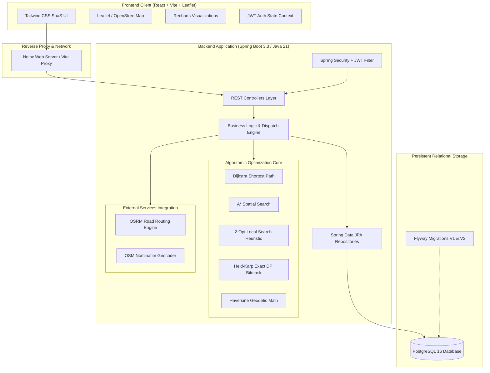
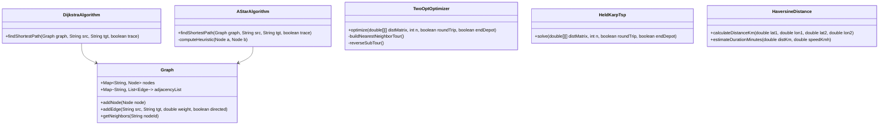
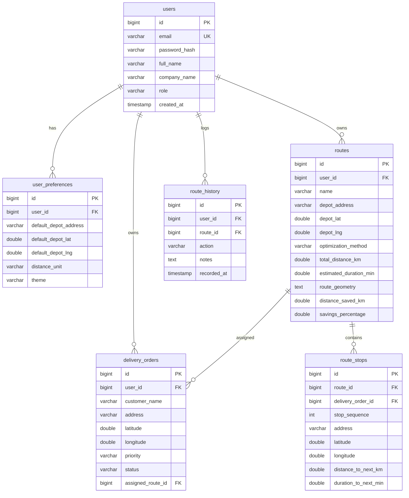

# RouteWise — Intelligent Route Optimization System

[](https://routewise-optimizer.vercel.app)
[](https://routewise-route-optimizer.onrender.com)
[](https://github.com/chriswin1125/RouteWise-Route-Optimizer)

🌐 **Live Application**: [https://routewise-optimizer.vercel.app](https://routewise-optimizer.vercel.app)  
🚀 **Backend Service**: [https://routewise-route-optimizer.onrender.com](https://routewise-route-optimizer.onrender.com)  
📖 **API Docs (Swagger)**: [https://routewise-route-optimizer.onrender.com/swagger-ui.html](https://routewise-route-optimizer.onrender.com/swagger-ui.html)

> **RouteWise** is a production-grade, full-stack logistics route planning and multi-stop optimization platform engineered with **Java 21, Spring Boot 3, PostgreSQL, React (Vite + Tailwind CSS), Leaflet, and Recharts**. It solves the Traveling Salesperson Problem (TSP) using 2-Opt local search heuristics and exact dynamic programming (Held-Karp), computes shortest paths with Dijkstra and A*, and integrates real-world road network routing via OpenStreetMap and OSRM.

---

## Live Deployments

| Component | Platform | URL | Status |
|---|---|---|---|
| **Frontend Web App** | **Vercel** | [https://routewise-optimizer.vercel.app](https://routewise-optimizer.vercel.app) | Production |
| **Backend API** | **Render** | [https://routewise-route-optimizer.onrender.com](https://routewise-route-optimizer.onrender.com) | Production |
| **Interactive API Docs** | **Swagger UI** | [https://routewise-route-optimizer.onrender.com/swagger-ui.html](https://routewise-route-optimizer.onrender.com/swagger-ui.html) | Available |

---

## Table of Contents
1. [Live Deployments](#live-deployments)
2. [System Architecture](#system-architecture)
3. [Key Features](#key-features)
4. [Technology Stack](#technology-stack)
5. [Mathematical Algorithms & Complexity](#mathematical-algorithms--complexity)
6. [Database Schema (Flyway Migrations)](#database-schema)
7. [API Endpoints Reference](#api-endpoints-reference)
8. [Getting Started (Local & Docker)](#getting-started)
9. [Automated Verification & Testing](#automated-verification--testing)
10. [Example API Request & Response](#example-api-request--response)
11. [Default Credentials & Development Dataset](#default-credentials)

---

## System Architecture



---

## Key Features

1. **Multi-Stop Route Optimization (TSP)**:
   - Takes a starting depot, an optional distinct return depot, and multiple delivery stops.
   - Initial tour constructed via greedy **Nearest-Neighbor** heuristic.
   - Tour iteratively untangled using **2-Opt local search** (edge reversals) until reaching local optimality.
   - For stop counts $N \le 12$, supports **Held-Karp Dynamic Programming with Bitmask** for proven mathematical global optimality.
2. **Real Road Network Geometry**:
   - Integrates with the **Open Source Routing Machine (OSRM)** road routing engine to retrieve turn-by-turn geometry and driving durations.
   - Seamless, resilient fallback to **Haversine great-circle distance matrix** with explicit `isEstimated: true` flags if external network services are unreachable.
3. **Point-to-Point Shortest Paths**:
   - **Dijkstra's Algorithm** with min-heap priority queue ($O((|V| + |E|) \log |V|)$).
   - **A* Algorithm** leveraging an admissible Euclidean / Haversine spatial heuristic to explore significantly fewer nodes.
4. **Interactive Algorithm Visualizer**:
   - Step-by-step technical interview demonstration on a weighted logistics graph.
   - Inspects priority queue states, tentative distance relaxations, visited vs. unvisited node sets, and formal asymptotic complexity.
5. **Route Comparison & Benchmarking**:
   - Side-by-side comparison of baseline sequence order vs. optimized routes.
   - Recharts visual bar charts and percentage improvements: $\frac{D_{\text{baseline}} - D_{\text{optimized}}}{D_{\text{baseline}}} \times 100\%$.
6. **Delivery Order Fulfillment Management**:
   - Full CRUD lifecycle: `PENDING`, `ASSIGNED`, `IN_TRANSIT`, `DELIVERED`, `CANCELLED`.
   - Priority tagging (`LOW`, `MEDIUM`, `HIGH`, `URGENT`), auto-geocoding, and one-click assignment to the Route Planner.
7. **Strict Multi-Tenant Data Isolation**:
   - User ownership verification enforced across all routes, delivery orders, and execution histories.
   - BCrypt password hashing, stateless JWT authentication, and Spring Security method guards.

---

## Technology Stack

| Layer | Technologies |
|---|---|
| **Frontend** | React 18/19, Vite, Tailwind CSS v4, React Router v7, Leaflet, React-Leaflet, Recharts, Lucide React |
| **Backend** | Java 21, Spring Boot 3.3.4, Spring Security 6, Spring Data JPA, Spring Validation, JJWT 0.12.6, Maven 3.9 |
| **Database** | PostgreSQL 16, Hibernate ORM, Flyway Migrations (V1 Schema + V2 Sample Data), H2 (Test Profile) |
| **Algorithms** | Dijkstra (Min-Heap PQ), A* Search, 2-Opt Local Search, Held-Karp (Bitmask DP), Haversine |
| **Integrations** | OSRM Table & Route API, OpenStreetMap Nominatim Geocoding API |
| **Testing** | JUnit 5, Mockito, Spring Boot Test, Vitest, React Testing Library, JSDOM |
| **DevOps** | Docker, Docker Compose, Nginx, Multi-Stage Container Builds |

---

## Mathematical Algorithms & Complexity



### Algorithmic Breakdown:

1. **Dijkstra's Algorithm**:
   - **Time Complexity**: $\mathcal{O}((|V| + |E|) \log |V|)$
   - **Space Complexity**: $\mathcal{O}(|V| + |E|)$
   - Uses a binary min-heap (`PriorityQueue`) to extract the unvisited node with minimal tentative distance. Relaxations ensure monotonicity over non-negative weights.

2. **A* Search Algorithm**:
   - **Time Complexity**: $\mathcal{O}(|E| \log |V|)$ in typical scenarios with an admissible heuristic; degrades to Dijkstra worst-case if $h(n) = 0$.
   - **Space Complexity**: $\mathcal{O}(|V|)$
   - Heuristic function $f(n) = g(n) + h(n)$. Straight-line Euclidean/Haversine distance satisfies $h(n) \le d(n, \text{goal})$, guaranteeing optimality.

3. **2-Opt Multi-Stop Heuristic**:
   - **Time Complexity**: $\mathcal{O}(k \cdot N^2)$, where $k$ is iteration count ($k \le 500$) and $N$ is stop count.
   - **Space Complexity**: $\mathcal{O}(N)$
   - Evaluates whether swapping edge pairs $(i, i+1)$ and $(j, j+1)$ reduces tour distance by more than $\epsilon = 10^{-6}$.

4. **Held-Karp Exact TSP (Dynamic Programming)**:
   - **Time Complexity**: $\mathcal{O}(N^2 \cdot 2^N)$
   - **Space Complexity**: $\mathcal{O}(N \cdot 2^N)$
   - Sub-tour memoization state $dp(\text{mask}, u)$ solves the NP-hard TSP to provable global optimality for small delivery fleets ($N \le 12$).

---

## Database Schema



---

## API Endpoints Reference

### Authentication
- `POST /api/auth/register` — Register new user account
- `POST /api/auth/login` — Authenticate and receive JWT access token
- `GET /api/auth/me` — Retrieve current authenticated user and preferences
- `PUT /api/auth/preferences` — Update default depot hub, distance unit, and theme

### Routes
- `POST /api/routes/optimize` — Calculate optimized multi-stop route
- `POST /api/routes/compare` — Compare original baseline order vs. 2-Opt and Held-Karp
- `POST /api/routes/shortest-path` — Point-to-point Dijkstra or A* path
- `POST /api/routes` — Save route to database
- `GET /api/routes` — List user saved routes (with pagination and search)
- `GET /api/routes/{id}` — Get route details and stop sequence
- `PUT /api/routes/{id}` — Update existing saved route
- `DELETE /api/routes/{id}` — Delete saved route

### Deliveries
- `POST /api/deliveries` — Create delivery order
- `GET /api/deliveries` — List orders (search, sort, filter by status and priority)
- `GET /api/deliveries/pending` — Get all unassigned pending orders
- `GET /api/deliveries/{id}` — Get delivery order by ID
- `PUT /api/deliveries/{id}` — Update delivery order details
- `PATCH /api/deliveries/{id}/status` — Update order status (`PENDING` → `DELIVERED`)
- `DELETE /api/deliveries/{id}` — Delete delivery order

### Locations
- `GET /api/locations/search?q={query}` — Debounced address lookup via Nominatim
- `POST /api/locations/geocode` — Convert text address to geographic coordinates

### Dashboard
- `GET /api/dashboard/summary` — Aggregate KPIs (total deliveries, distance saved, recent routes)
- `GET /api/dashboard/analytics` — Time-series distance savings and algorithm metrics

### Algorithms
- `POST /api/algorithms/dijkstra/trace` — Step-by-step trace of Dijkstra's algorithm
- `POST /api/algorithms/a-star/shortest-path` — Step-by-step trace of A* Search
- `GET /api/algorithms/sample-graph` — Retrieve sample logistics network topology

---

## Getting Started

### Prerequisites
- **Java**: JDK 21
- **Node.js**: v20+ / v22+
- **Docker & Docker Compose**: (Optional, for containerized run)

### 1. Running with Docker Compose (Recommended)

To run the complete system (PostgreSQL 16 + Spring Boot Backend + React Frontend):

```bash
# 1. Copy sample environment file
cp .env.example .env

# 2. Build and launch all services
docker compose up --build
```

Access the applications:
- **Frontend Web App**: `http://localhost:3000`
- **Backend REST API**: `http://localhost:8080`
- **Swagger / OpenAPI Documentation**: `http://localhost:8080/swagger-ui.html`

To stop:
```bash
docker compose down
```

---

### 2. Running Locally for Development

#### A. Backend (Spring Boot 3)
```bash
cd backend

# Compile and run with PostgreSQL (or H2 in-memory profile)
mvn spring-boot:run -Dspring-boot.run.profiles=postgres
```
*Tip: If running without a local PostgreSQL instance, run with the `h2` profile:*
```bash
mvn spring-boot:run -Dspring-boot.run.profiles=h2
```

#### B. Frontend (Vite + React)
```bash
cd frontend

# Install dependencies (if not already done)
npm install

# Start local dev server (proxies /api to localhost:8080)
npm run dev
```
Open `http://localhost:5173` in your browser.

---

## Automated Verification & Testing

### Run Backend Tests (JUnit 5 + Mockito)
```bash
cd backend
mvn test "-Dspring.profiles.active=test"
```
*Executes all 27 tests covering Dijkstra, A*, 2-Opt local search, Held-Karp exact optimality, Haversine formula, OSRM resilience fallback, data isolation, and service layers.*

### Run Frontend Tests (Vitest + Testing Library)
```bash
cd frontend
npm test
```
*Executes all unit tests verifying components, status/priority badges, skeleton loaders, and authentication flows.*

---

## Example API Request & Response

### Multi-Stop Route Optimization (`POST /api/routes/optimize`)

**Request:**
```json
{
  "name": "San Francisco Central Dispatch",
  "depotAddress": "Central Hub, 500 Howard St, San Francisco, CA",
  "depotLatitude": 37.7885,
  "depotLongitude": -122.3995,
  "roundTrip": true,
  "algorithm": "HEURISTIC_2OPT",
  "stops": [
    {
      "sequence": 1,
      "customerName": "Fishermans Wharf Gift Shop",
      "address": "2801 Leavenworth St, San Francisco, CA",
      "latitude": 37.8080,
      "longitude": -122.4177
    },
    {
      "sequence": 2,
      "customerName": "Mission District Clinic",
      "address": "2450 Mission St, San Francisco, CA",
      "latitude": 37.7587,
      "longitude": -122.4191
    },
    {
      "sequence": 3,
      "customerName": "Embarcadero Tech Labs",
      "address": "201 Mission St, San Francisco, CA",
      "latitude": 37.7915,
      "longitude": -122.3972
    }
  ]
}
```

**Response (`200 OK`):**
```json
{
  "name": "San Francisco Central Dispatch",
  "depotAddress": "Central Hub, 500 Howard St, San Francisco, CA",
  "depotLatitude": 37.7885,
  "depotLongitude": -122.3995,
  "roundTrip": true,
  "optimizationMethod": "HEURISTIC_2OPT",
  "totalDistanceKm": 14.82,
  "estimatedDurationMin": 38.5,
  "isEstimated": false,
  "baselineDistanceKm": 21.2,
  "baselineDurationMin": 55.0,
  "distanceSavedKm": 6.38,
  "savingsPercentage": 30.09,
  "stops": [
    {
      "sequence": 1,
      "customerName": "Embarcadero Tech Labs",
      "address": "201 Mission St, San Francisco, CA",
      "latitude": 37.7915,
      "longitude": -122.3972,
      "distanceToNextKm": 2.3,
      "durationToNextMin": 7.5
    },
    {
      "sequence": 2,
      "customerName": "Fishermans Wharf Gift Shop",
      "address": "2801 Leavenworth St, San Francisco, CA",
      "latitude": 37.8080,
      "longitude": -122.4177,
      "distanceToNextKm": 6.8,
      "durationToNextMin": 16.0
    },
    {
      "sequence": 3,
      "customerName": "Mission District Clinic",
      "address": "2450 Mission St, San Francisco, CA",
      "latitude": 37.7587,
      "longitude": -122.4191,
      "distanceToNextKm": 4.5,
      "durationToNextMin": 12.0
    }
  ]
}
```

---

## Default Credentials & Development Dataset

The database migration `V2__sample_data.sql` pre-seeds test fleet operators and deliveries:

| Email | Password | Role | Description |
|---|---|---|---|
| `demo@routewise.com` | `Password123!` | `ROLE_USER` | Pre-seeded with SF delivery orders, active routes, and historical logs |
| `john.doe@logistics.com` | `Password123!` | `ROLE_USER` | Secondary user account for testing data isolation |

*Note: On the login page, you can click the **"Demo Fill"** button to automatically populate the demo credentials and sign in with a single click.*
